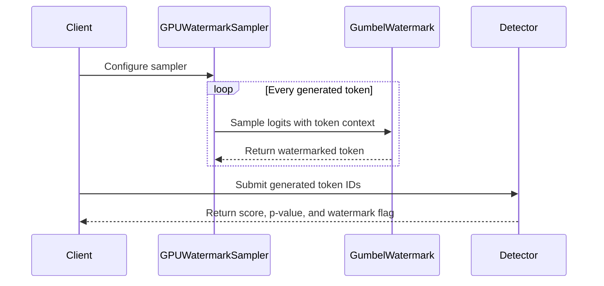

# Gibbous

Pleasant GitHub

## Features

- 🌔/🌘 turns everything on or off.
- Does nothing on phone-sized windows.
- 👀 above a repo's files hides the ones you pick, like CNAME. They stay hidden.
- Hides buttons like Copilot and Workflows.
- If you have a fork, the upstream repo links to it.
- On repos you own, can push to, or forked, the sidebar loses topics, links, stats, Watch and Fork. Releases get a Tags panel next to them. Contributors and languages move to tabs next to README.
- Repos where you have open pull requests get a My pull requests tab, first. The license, code of conduct, contributing and security tabs move into a ⋯ menu.
- Pull requests show a second +/− count that ignores whitespace, like `?w=1`. Click it to hide whitespace in the diff.
- Each diff hunk gets a Viewed checkbox that folds it to its `@@` line. A later push that changes the hunk unfolds it. Works in Changes and in the classic Files view.
- A link to a line in a diff GitHub didn't load (too large) loads it and scrolls to the line.
- In pull request conversations, a quote links to the comment it quotes, and that comment links back.
- Mermaid diagrams open in a lightbox. Scroll or double-click to zoom, drag to pan, Esc to close.

### Try the Mermaid lightbox

With Gibbous on, click Enlarge on this diagram. Scroll or double-click to zoom, drag to pan, 0 to refit, Esc to close.

## Install

[Privacy policy](https://netanel-haber.github.io/gibbous/privacy.html)

  

  <a href="https://www.flickr.com/photos/john-spade/6680460959/">Moon Waxing Gibbous January 2012</a>
  by <a href="https://www.flickr.com/photos/john-spade/">daspader</a>, licensed under
  <a href="https://creativecommons.org/licenses/by/2.0/">CC BY 2.0</a>.

